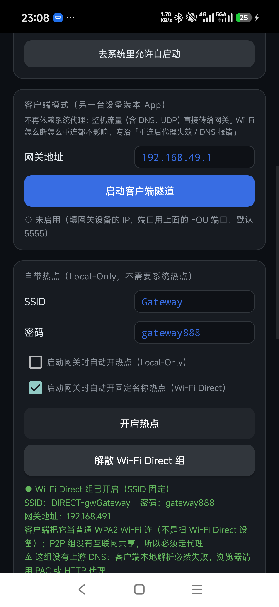
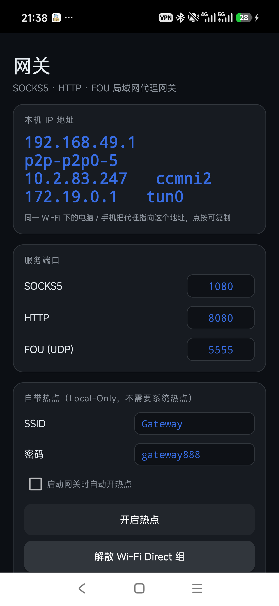

# PocketGateway · 口袋网关

把一台闲置安卓手机变成**随身 Wi-Fi 代理网关**。

它会自己开热点，热点下的电脑、平板、另一台手机把代理指过来就能上网；同一套 App 也能反过来用 —— 把整机流量经隧道丢给另一台网关。不需要 root。

<p align="center">
  <a href="https://github.com/dosgo/pocket-gateway/releases/latest"></a>
  
  
  <a href="LICENSE"></a>
</p>

<p align="center">
  
  
</p>

## 用来做什么

- **出差 / 住酒店**：手机连上酒店 Wi-Fi，自己再开一个热点，笔记本不用反复过认证页
- **临时多设备共享**：一台手机做出口，其他设备连上来统一走代理，规则只在一处维护
- **给不支持的设备做出口**：老平板、电视盒子填不了代理，让它连这个热点就行
- **没有路由器**：手机用移动数据，自带热点直接分出去

## 功能

| | |
| --- | --- |
| **四个入口** | SOCKS5 `1080` · HTTP `8080` · FOU `5555/udp` · WireGuard `51820/udp`，端口可改，可同时开 |
| **两种热点** | Local-Only 热点（SSID 由系统生成）与 **Wi-Fi Direct 固定组**（SSID 固定 `DIRECT-gwGateway`） |
| **客户端模式** | `VpnService` 接管整机流量，经 FOU 隧道转给网关，不用逐台配代理 |
| **WireGuard** | 标准协议接入，官方客户端扫码导入 `.conf` 即全流量（TCP/UDP）走网关，客户端不用装本 App |
| **开机自启** | 解锁前就能拉起服务（Direct Boot），解锁后补开热点 |
| **HTTP 代理** | 标准 `CONNECT` 隧道，HTTPS 端到端，不解密、不碰证书 |
| **诊断** | 浏览器打开 `http://网关IP:8080` 有状态页、`/proxy.pac` 可自动配置、`/dns?host=` 查解析 |

## 下载

[Releases](https://github.com/dosgo/pocket-gateway/releases/latest) 页面下载 APK 安装即可。Android 7.0+，无需 root。

<details>
<summary>如果 adb 安装被系统拦（报 <code>reject adb install</code>）</summary>

部分国产 ROM 在开发者选项里默认关闭「USB 安装」，用 PackageInstaller 会话可以绕过：

```bash
adb push PocketGateway-3.0.apk /data/local/tmp/gw.apk
SZ=$(stat -c %s PocketGateway-3.0.apk)
SID=$(adb shell pm install-create -r -t -S $SZ | grep -o '[0-9]\+')
adb shell pm install-write -S $SZ $SID base /data/local/tmp/gw.apk
adb shell pm install-commit $SID
```

</details>

## 快速上手

### 当网关用

1. 打开 App，点「启动网关」（首次会要通知权限）
2. 需要热点就点「固定名称热点（Wi-Fi Direct）」，卡片里会显示 SSID、密码和网关地址
3. 其他设备连上这个热点，代理填卡片上的 `网关地址:8080`（或 `:1080`）

### 用 WireGuard 客户端连

1. 网关卡片里点「启动 WireGuard」（端口默认 `51820/udp`）
2. 卡片会显示服务端公钥 + 二维码，客户端用官方 WireGuard App 扫码，或点文字复制 `.conf` 导入
3. 客户端里 `AllowedIPs = 0.0.0.0/0`，连上后整机流量（TCP/UDP、DNS）都经网关出去；ping 由网关本地应答

> 服务端与客户端密钥由 App 自动生成并保存在本机；换密钥后旧配置立即失效。FOU 与 WireGuard 可以同时开。

### 当客户端用

1. 另一台设备装同一个 App，在「客户端」卡片里填网关 IP（固定组默认 `192.168.49.1`）
2. 点「开启客户端隧道」，授权 VPN 即可

### 开机自动

「自启动」卡片勾「开机自动启动网关」，热点卡片再勾一项「启动网关时自动开…」（两种热点互斥）。

> 国产 ROM 需要在系统「自启动管理」里放行本应用，App 里有按钮直接跳过去。

## 它是怎么走的

```
   笔记本 / 平板 / 电视盒子
            │
            │  ① 系统代理 → SOCKS5 / HTTP
            │  ② 或客户端模式 → VpnService → FOU 隧道
            ▼
    ┌───────────────────────────┐
    │  网关手机                  │
    │  热点 (10.x / 192.168.49)  │
    │  SOCKS5 · HTTP · FOU       │
    └─────────────┬─────────────┘
                  │ Wi-Fi 或移动数据
                  ▼
                互联网
```

各入口的区别：SOCKS5 最通用（支持 UDP），HTTP 对浏览器和系统代理最省事，FOU 是网络层、给自带客户端模式用，WireGuard 是标准 VPN 协议、给任何平台的官方客户端用（TCP/UDP 全流量，ICMP echo 本地应答）。

## 性能调优（3.7）

FOU 链路的端到端 RTT 通常是蜂窝 RTT + 两层用户态转发 + 空口，常在 150ms 上下。这种「长肥链路」下，**单条 TCP 的吞吐由拥塞控制算法决定，不是由接收窗口决定** —— 窗口早在 3.6 就已经是 1MB 并关掉了自动调优，但 gVisor 的 `tcp.NewProtocol` 默认跑 **Reno**：丢一个包 cwnd 砍半，之后每个 RTT 只涨 1 个 MSS，恢复一次要几十个 RTT，速度就被压在几百 KB/s 且非常「稳」。

3.7 做的几处：

| 位置 | 改动 | 针对什么 |
| --- | --- | --- |
| `gostack/fougw/netstack.go` | 拥塞控制 Reno → **CUBIC** | 窗口增长与 RTT 解耦，丢包后恢复快得多（Linux 默认算法） |
| 同上 | `io.Copy` → `io.CopyBuffer` + `sync.Pool` 64KB | 每条连接少两次 32KB 分配，降低并发时的 GC 抖动 |
| `gostack/fougw/gateway.go` | 隧道索引 key 由 `"ip:port"` 字符串 → `[4]byte + uint16` 结构 | 每个包少 3 次堆分配；收包热路径从全局写锁降为读锁 + 一次原子写 |
| `ClientVpnService.java` | FOU UDP socket 收发缓冲申请 1MB，复用 `DatagramPacket` | **仅客户端模式**；Android 默认 UDP 缓冲只有一两百 KB，蜂窝侧突发会灌满并丢包 |
| `gostack/fougw/gateway.go` | 把 UDP socket 的实际收发缓冲读回并打日志 | 网关模式收 FOU 包的 socket 在 Go 侧，早就申请了 4MB，但 `SetReadBuffer` 会被内核静默截断，之前无从确认 |

启动日志（App 状态页，或 `adb logcat -s Gateway:I`）：

- **网关模式**（手机跑 FOU 服务端）：`WG TCP 拥塞控制 = cubic…`，以及 `FOU UDP socket 缓冲：申请 4096KB，实际 rx=…KB tx=…KB（内核上限 rx=…KB tx=…KB）`。注意 Linux 的 `SO_RCVBUF`/`SO_SNDBUF` 读回值含 skb 开销，约为申请值的 2 倍（8MB）属正常；明显不到就说明被 ROM 的 `rmem_max`/`wmem_max` 截断了，App 改不动。
- **客户端模式**（另一台设备）：才有 Java 层的 `FOU socket 缓冲 rx=…B tx=…B（申请 1048576B）`。

Windows 桌面 CLI 读不到实际值，日志会显示「当前平台读不回实际值」。

**怎么判断瓶颈在哪一侧**（配合 ESP32 固件的 `http://192.168.4.1/speed` 端点，它由 ESP32 本地生成 4MB 数据，完全绕开 FOU / 手机 / 蜂窝）：

| `/speed` 结果 | 结论 |
| --- | --- |
| ≥ 1MB/s，但上网仍只有几百 KB/s | 空口和 ESP32 清白，瓶颈在手机蜂窝 RTT / TCP 栈 —— 正是 CUBIC 要对症的场景 |
| 也只有几百 KB/s | 瓶颈在 2.4G 空口，去固件网页试 1/6/11 信道 × 20/40MHz |

另一个快速判据：用多线程下载工具（4–8 连接）下同一个大文件。总速度随连接数上涨 = 单连接被 cwnd / RTT 卡住；总速度不动 = 链路级上限。

## 从源码构建

不依赖 Gradle 联网，直接调 SDK 里的 `aapt2` / `javac` / `d8` / `apksigner`：

```bash
bash build_aar.sh     # Go 侧 FOU 引擎 → gomobile bind → app/libs/fougw.aar
bash build_apk.sh     # → Gateway-x.x.apk（release 签名，首次自动生成 keystore）
bash build_debug.sh   # → Gateway-x.x-debug.apk（debuggable + debug 证书）
```

需要 JDK 17、Android SDK（build-tools 35、platform 33）、Go 1.22+ 与 `gomobile`。如果只想改 Java 部分，`fougw.aar` 已在仓库里，跳过第一步即可。

## 已知限制

- **热点 SSID 无法指定**（Local-Only 热点）：这是 Android 的限制，`NETWORK_SETTINGS` 是签名权限。需要固定名字请用 Wi-Fi Direct 模式。
- **解锁前开不了热点**：Direct Boot 阶段 Wi-Fi 服务还没就绪，服务能起、代理端口能开，AP 要等解锁后才建得起来。
- 只转发 IPv4；SOCKS5 无认证（局域网自用，别直接暴露到公网）。
- 运行中被系统杀掉不会自动复活，也不做 Wi-Fi 开关的自动恢复 —— 需要手动点一下。
- 热点与 Wi-Fi 同时工作取决于芯片；本机实测 4G + 热点可以并存。

更多实现细节、真机实测记录和踩过的坑，见 [docs/NOTES.md](docs/NOTES.md)。

## 许可

[MIT](LICENSE)。请只用在自己的设备和自己的网络上，并遵守当地法律法规与所用网络的服务条款。
